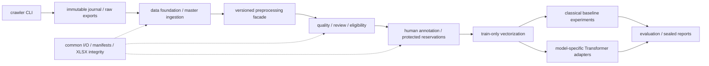

# Repository map

Read [current pipeline](../CURRENT_PIPELINE.md),
[project evolution](../PROJECT_EVOLUTION.md) and
[experiment results](../EXPERIMENT_RESULTS.md) first. This map identifies code
ownership; [consolidation decisions](CONSOLIDATION_PLAN.md) records compatibility.

Current workflow is quality review, not model fitting. Experiment dependencies
are separate from current runtime. Historical phase modules remain versioned
engines because real manifests pin code/config/resource hashes.

| Owner | Responsibility | Recommended entry |
| --- | --- | --- |
| src/crawler | Selenium DOM extraction, limits, journal/resume/export | `python -m src.crawler interactive` |
| src/data | Foundation schema, snapshot, grouped split, validation | prepare_data.py / validate_data.py; reproduction |
| src/dataset/master.py, test_posts.py, blind.py | Master provenance, whole-post quarantine, independent-test gates | existing source-intake CLI; no collection during cleanup |
| src/preprocessing | raw-derived version engines and one public dispatch API | `from src.preprocessing import preprocess` |
| src/dataset/common.py | CSV/JSONL, SHA/seal/verify, shared XLSX reader/ID integrity | imported utility, not a workflow CLI |
| src/dataset/quality_review.py | Current prepare/import/evaluate/freeze/export routing and human ledger | `python -m src.dataset.quality_review --help` |
| quality_readiness.py / quality_release.py | Fixed quality rules, eligibility and explicit approval gates | routed through quality_review; rule code remains pinned |
| src/annotation | Historical blind annotation/agreement/silver/release contracts | `python -m src.annotation --help` |
| src/baseline | Classical models, preprocessing ablations, robustness diagnostics | `python -m src.baseline --help`; experiment scripts indexed in results |
| src/transformer | Model-specific input, checkpoint/fold execution | run_phase_h.py; experimental, not run in current task |
| tests | Unit/integration/regression fixtures in existing discoverable layout | `python -m unittest discover -s tests` |

The same validator framework must not conflate format ACCEPT with domain
IN_DOMAIN or sentiment POS. Shared integrity primitives are reusable; the
decision enums, evidence fields and approval gates remain schema-specific.

## Files intentionally retained

- configs/: active `phase_j_v1.json`, normalization `phase_i4_1.json`, shared
  abbreviation/lexicon resources; older experiment configs stay at pinned paths.
- data/ and outputs/: original imports, human decisions and research artifacts;
  outputs/README.md is the local navigation. No artifact relocation/deletion.
- gan_nhan.py, trich_dac_trung.py, crawl/: legacy/reproduction tools, not the
  recommended current quality/normalization path. They are kept because CLI,
  fixtures and handoff references still exist.
- scripts/: one-line compatibility adapters for the current quality CLI and
  explicit reproduction scripts for experiments. Historical schemas/builders
  remain available; superseded does not mean safe to delete.
- requirements/: environment-owned pins and locks; root requirements-* paths
  are compatibility includes. See [environment setup](../guides/ENVIRONMENT.md).

Inventory (tracked and local), import graph, checksum pins, path literals and
move map are local at outputs/repository_audit/. They may contain user paths;
do not commit those raw inventories or infer permission to remove UNKNOWN files.
