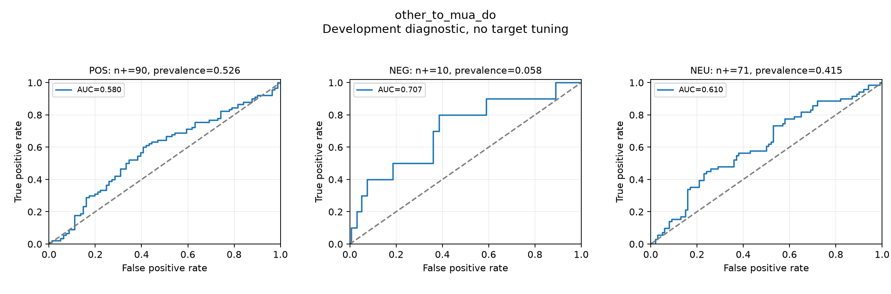
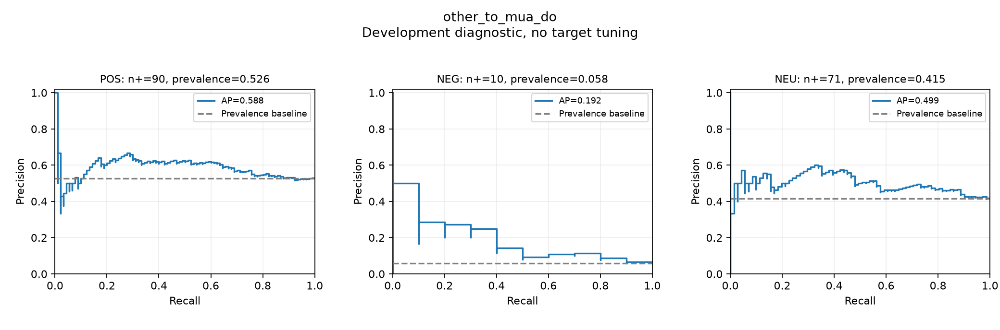
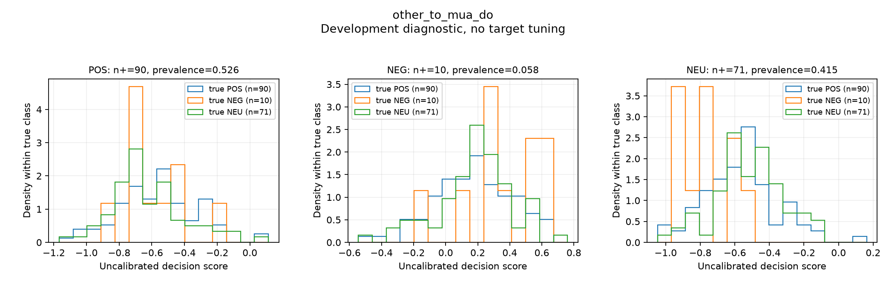
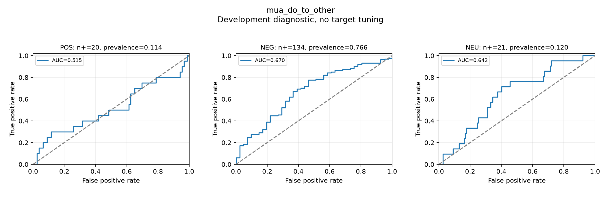
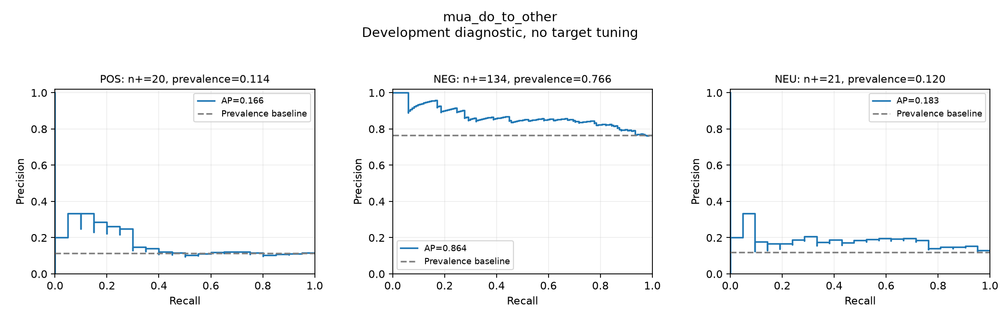
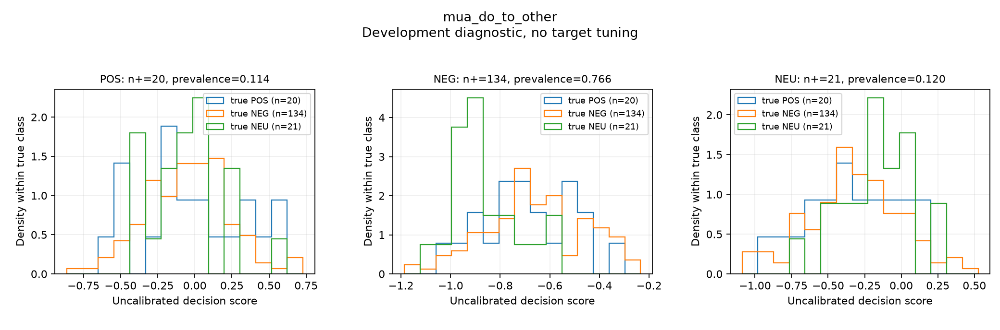

# Phase E.2 — Cross-domain Ranking Diagnostics

Ngày 11/11/2026. Khóa Phase E.1 tại commit 825c099, đúng 346 nhãn người,
char_wb TF-IDF (3–5) + L2 + LinearSVC C=1, class_weight=balanced, RNG=42.
Dùng nguyên train/evaluation IDs của hai transfer E.1, không đổi dữ liệu,
guideline, split, feature hoặc threshold. Fit vectorizer chỉ trên miền train.

## Kết quả

| Chiều | Lớp | Support dương | Prevalence / baseline AP | ROC-AUC OvR | Average Precision |
|---|---|---:|---:|---:|---:|
| other_to_mua_do | POS | 90 | 0.5263 | 0.5801 | 0.5875 |
| other_to_mua_do | NEG | 10 | 0.0585 | 0.7068 | 0.1919 |
| other_to_mua_do | NEU | 71 | 0.4152 | 0.6096 | 0.4994 |
| mua_do_to_other | POS | 20 | 0.1143 | 0.5155 | 0.1663 |
| mua_do_to_other | NEG | 134 | 0.7657 | 0.6698 | 0.8640 |
| mua_do_to_other | NEU | 21 | 0.1200 | 0.6422 | 0.1827 |

Classification gốc được tái tạo đúng từng ID/prediction và mọi metrics:

- Other → Mưa Đỏ: Macro-F1 **0,0707**, accuracy **0,0819**, recall POS/NEG/NEU
  **0,0222 / 1,0000 / 0,0282** (2/90 POS, 10/10 NEG, 2/71 NEU đúng).
- Mưa Đỏ → Other: Macro-F1 **0,1397**, accuracy **0,1257**, recall POS/NEG/NEU
  **0,6500 / 0,0000 / 0,4286** (13/20 POS, 0/134 NEG, 9/21 NEU đúng).

## Ranking và quyết định nhãn là hai câu hỏi khác nhau

LinearSVC trả native classes_ **NEG, NEU, POS**. Code ánh xạ rõ sang
**POS, NEG, NEU** khi xuất và đo OvR; kiểm argmax theo native class order phải
trùng predict (giữ đúng quy tắc tie của estimator). Score không phải xác suất. ROC-AUC đánh giá thứ hạng của một
lớp so với phần còn lại; argmax multiclass còn phụ thuộc quan hệ score giữa
các lớp. AP là average precision của sklearn, không phải diện tích PR tính
bằng trapezoid. Baseline PR theo prevalence được vẽ cho từng lớp/miền.

Có tín hiệu ranking hạn chế: Other → Mưa Đỏ, POS AUC 0,580 và NEU 0,610 chỉ
phân biệt yếu; NEG AUC 0,707/AP 0,192 cao hơn baseline 0,058 nhưng chỉ có 10
mẫu dương. Chiều ngược lại POS AUC 0,515 gần mức chance; NEU AUC 0,642/AP
0,183 so baseline 0,120; NEG AUC 0,670 dù argmax không chọn đúng NEG nào.
NEG AP 0,864 ở chiều này phải đối chiếu prevalence rất cao 0,766, không đọc
như một kết quả nhận diện gần hoàn hảo.

Vì vậy có sự lệch giữa ranking và quyết định, đặc biệt NEG ở chiều ngược;
nhưng không đủ kết luận thất bại **chỉ** vì threshold/intercept không phù hợp.
Ranking POS yếu và score các nhãn thật chồng lấn cho thấy khả năng phân biệt
cũng chưa mạnh. Không khẳng định high AUC chứng minh prior shift: prior,
class-conditional/covariate shift, source-topic/cộng đồng, cách lấy mẫu và
cách diễn đạt có thể cùng thay đổi; chưa kiểm định giả định label shift.
Không có nhãn target nào được dùng để calibrate, chọn offset, threshold,
hyperparameter hoặc lựa chọn mô hình cho test cuối.

## Mẫu ít và giới hạn

Mưa Đỏ có 171 câu ở ba bài: 90 POS / 10 NEG / 71 NEU; miền khác 175 câu:
20 POS / 134 NEG / 21 NEU. Khi Mưa Đỏ là evaluation, ROC NEG chỉ có 10 mẫu
dương và 161 âm, một mẫu làm recall đổi 0,1, PR rất bậc thang. Những câu
cùng bài không độc lập; không dựng CI giả từ bootstrap từng comment.
Khi Mưa Đỏ là train, classifier NEG học từ đúng 10 câu; score có ranking ở
miền khác không chứng minh nó đã học sentiment chung. POS 20 và NEU 21 ở
miền other cũng ít. AUC/AP chỉ mô tả tập đã chọn, không phải kiểm định hơn
chance hoặc hiệu năng quần thể; không so AP thô giữa miền có prevalence khác.
movie_id là chủ đề bài nguồn, không bảo đảm toàn câu chỉ nói một phim.
Hai phép này không phải independent gold test hoặc clean unseen-film test.

## Biểu đồ

Đường ROC/PR và score được xuất PNG + PDF; histogram dùng cùng bins cho mọi
nhãn thật trong mỗi trục, density chuẩn hóa riêng từng lớp để không che lấp
lớp ít mẫu. Các score quantiles và toàn bộ curve points có trong results.json.

### Other → Mưa Đỏ







### Mưa Đỏ → Other







## Tái lập và kiểm tra

```powershell
.\.venv-phase-e\Scripts\python.exe -m pip install -r requirements-phase-e2.txt
.\.venv-phase-e\Scripts\python.exe scripts/run_ranking_diagnostics.py
```

Config configs/ranking_diagnostics.json khóa manifest E.1. Output mới ở
outputs/phase_e2; từ chối ghi đè hoặc đặt trong E.1. Giữ results.json,
decision_scores.csv, ranking_comparison.csv, PNG/PDF, config và manifest
checksum. Nhãn từng câu/score giữ local, Git chỉ chia sẻ báo cáo/biểu đồ tổng
hợp và code. Score được trích bằng decision_function, không đổi dấu theo
kết quả target. Nếu binary target chỉ có một lớp, AUC/AP là null với reason,
không ép thành 0. Socket bị chặn suốt fit/predict/vẽ, không gọi GPT/Claude,
silver labeling hoặc Transformer. Phase E/E.1 và hai guideline nguyên vẹn.

**180/180 tests pass**; thêm test lớp thứ tự khác export, score không hữu hạn,
AUC/AP/prevalence/support, lớp nhị phân thiếu và ranking tốt nhưng argmax sai.
Đã đối chiếu độc lập tất cả 346 score/predictions với E.1 và tái tính sáu
AUC/AP từ CSV. Kết quả hỗ trợ tiếp tục nghiên cứu score/class decision bằng
validation tách riêng ở bước sau; chưa có căn cứ áp dụng threshold mới vào
miền đánh giá hiện tại hoặc bắt đầu mở rộng nhãn AI từ độ tự tin model.
